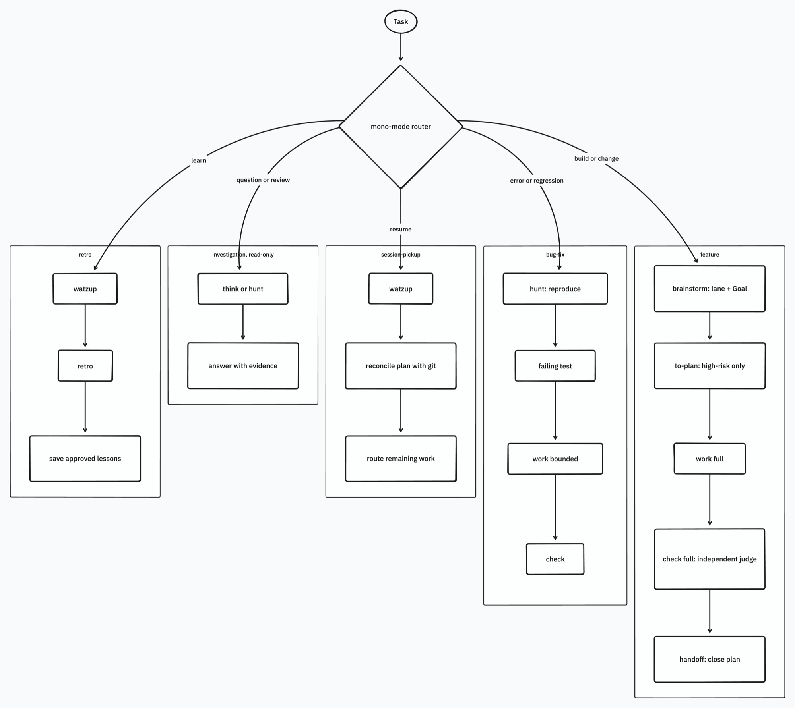
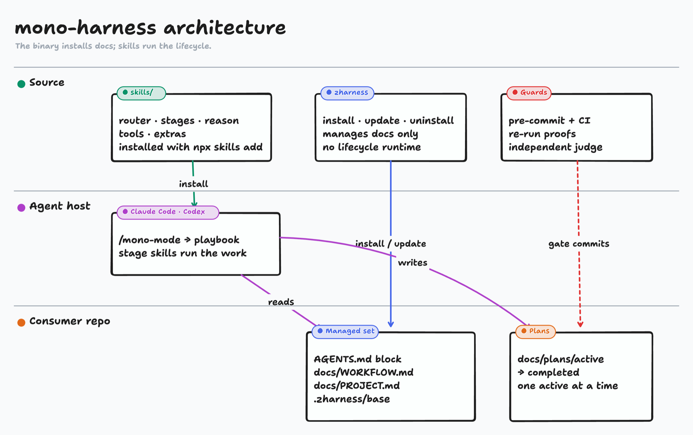

# mono-harness

Turn a git repository into a legible, agent-ready workspace.

`zharness` installs a small repository protocol and a safe updater. The
repository remains the system of record: product documents, decisions, plans,
code, tests, CI, and runtime evidence define the work.

It is not a task database, story tracker, agent orchestrator, or application
runtime. The binary scaffolds docs; it does not run the lifecycle.

Start with [`AGENTS.md`](AGENTS.md), then [`docs/WORKFLOW.md`](docs/WORKFLOW.md).

## Give this to a coding agent

Copy the block into the consumer repository chat when you want the agent to
install, refresh, or work with zharness.

```text
Work in this git repository. Read https://github.com/therealtinhtute/mono-harness/blob/master/README.md and, once they exist, this repo's AGENTS.md and docs/WORKFLOW.md. If zharness is not on PATH or outdated, install/upgrade it with scripts/install-zharness.sh. If this repo has no docs/WORKFLOW.md, run zharness install. Before upgrading, independently install the six workflow skills (brainstorm, to-plan, work, check, handoff, watzup) using the skills instructions below. If a required skill or reference is missing, report the dependency and stop workflow execution. If the repo is initialized or zharness install reports drifted files, run zharness update to refresh WORKFLOW and conservatively retire recorded legacy procedures (edited/unknown files and recovery data are retained; PROJECT.md is never overwritten, and an edited AGENTS.md block makes update refuse with a diff). Plans live only in docs/plans/ — multi-session or complex work uses exactly one file at docs/plans/active/{slug}.md, moved to docs/plans/completed/ upon verified handoff. Small changes need no plan. zharness only manages the doc set (install/update/uninstall) — it does not run the lifecycle. Missing AGENTS.md: zharness install, do not invent the file. Claude Code reads CLAUDE.md, not AGENTS.md; if CLAUDE.md is missing, the consumer writes a thin file containing the line @AGENTS.md.
```

## What it solves

Coding agents often fail for ordinary engineering reasons:

- important intent exists only in chat;
- the repository does not identify authoritative documents;
- small changes acquire unnecessary process;
- long changes lose decisions and recovery context;
- completion is claimed without behavior-level proof; and
- an agent invents product policy when the request leaves a material choice
  open.

zharness provides a compact entrypoint, a navigable repository map, durable
plans only when work needs them, and mono-mode playbooks that stay reduced for
read-only and bounded work.

## Goals

- **Skills and the harness are one goal.** This repository builds an agent
  skill set for the SDLC alongside `zharness`, the protocol that keeps that
  lifecycle legible and portable across coding agents.
- **The repository stays the system of record.** Plans, decisions, and
  validation live in tracked markdown that a human can read and git can
  history. There is no database — tracked markdown and git history are
  the only record.
- **Process proportional to the work.** A read-only question and a
  multi-session refactor should not cost the same ceremony. Reduced paths
  write no lifecycle rows; durable plans exist only for work that needs
  recovery context.
- **Invariants enforced, not assumed.** Where a rule can be checked it is
  checked — the pre-commit and CI plan guards fail on violation rather than
  letting a broken state travel silently. What they cannot check, they say so
  in `skills/stages/check/references/check-durable.md` instead of implying coverage.
- **Portable across agents.** The spine skills are thin triggers; the
  operating logic sits in independently installed skill references.
  Skill-capable hosts resolve each stage through their skill metadata; the CLI
  installs the repository router, not the procedures.
- **Diagnostics that name the next action.** A finding states the violating
  item, the rule it breaks, its authority, and what to do — never a bare
  validation failure.
- **Safe to adopt and to leave.** `install`/`update`/`uninstall` manage only
  the doc set, merging rather than clobbering the files a project owns; the one
  exception is `update` migrating a 9-section active plan, Validation bytes kept.

## Non-goals

- **Not a task database, tracker, or orchestrator.** zharness scaffolds and
  checks documents. It does not run the lifecycle, assign work, or drive an
  agent.
- **No database.** Anything that must outlive the working copy belongs
  in tracked markdown or in git history.
- **No hosted or shared state.** The CLI makes no network calls. Everything
  the harness knows lives in the working copy.
- **Not a replacement for git.** The harness records intent and validation;
  git remains the record of what changed.
- **No derived-fact documents.** Routes, environment variables, and file
  inventories are not hand-maintained in `docs/` — the code is authoritative
  for what can be re-derived from it.
- **No automatic remediation.** Gates report verdicts and findings; deciding
  what to do about them stays with the operator.

## Default workflow

Start a task with `/mono-mode <task>`. The router matches one playbook, copies
its steps into a todo list, and calls the skill each step names.



| Playbook | Steps |
|---|---|
| feature | brainstorm → to-plan (high-risk only) → work → check → git (on request) → handoff |
| bug-fix | hunt → failing test → work (bounded) → check → git (on request) |
| investigation | think or hunt; read-only, changes nothing |
| session-pickup | watzup → reconcile → route to the next playbook |
| retro | watzup → retro → save approved lessons |

A typo does not need a plan. A migration spanning sessions does: it gets one
`docs/plans/active/<plan>.md`, moved to `docs/plans/completed/` after
validation. When a request leaves a material product choice open, the agent
stops before mutation and asks.



Diagram sources are tldraw files in [`assets/diagrams/`](assets/diagrams/).

## What gets installed

The managed set is:

- a compact `AGENTS.md` entrypoint (marked `ZHARNESS` block only);
- `docs/WORKFLOW.md`, the stage router;
- a `docs/PROJECT.md` identity scaffold;
- `.zharness/base/` for update tracking (a sha256 manifest and the ownership ledger).

It does not write `CLAUDE.md`. It does not install application architecture,
product policy, skills, git hooks, credentials, a database, schemas,
orchestration, or background processes.

## Install

From a target repository, with `zharness` on PATH:

```bash
zharness install
```

Get the binary once per machine (`gh` + `tar`; Linux or macOS, amd64 or arm64):

```bash
bash scripts/install-zharness.sh
zharness --version
```

`install` is idempotent. It records upstream hashes, prints a read-only
brownfield report, and exits 0. Use `--root <dir>` when cwd is not the
consumer repo.

## Maintain an installation

```bash
zharness update
zharness update --force
zharness update --check [--all]
zharness uninstall
```

`docs/WORKFLOW.md` is a pure upstream mirror: update always overwrites it
with the latest bytes. Legacy procedures are retired only using recorded hashes
and ownership. Matching installer-created copies are removed; matching copies
with proven pre-install originals are restored. Edited or uncertain files and
their recovery data are retained with notices. See the [migration guide](docs/workflow-harness/skill-procedure-migration.md). `docs/PROJECT.md` is written only
when absent; after that it belongs to the project. The marked `AGENTS.md` block
is replaced between its markers; if it was edited since zharness last wrote it,
update prints the diff, writes nothing, and exits non-zero until you move the
edit outside the markers or pass `--force` (rerunning `install` resets the block without asking). `--check` reports drift without
writing (`--all`: every repository in `~/.config/zharness/repos`). A single active
plan in the older 9-section format is migrated in place to the 5-section format
with its `## Validation` bytes unchanged; any other heading set, or more than one
active plan, is left alone with a `notice`. Uninstall
removes managed files only; consumer-owned bytes are never deleted.

## Workflow skills and optional extensions

Install **brainstorm, to-plan, work, check, handoff and watzup** independently
before upgrading to skill-owned procedures. Verify that the host exposes all six
skills and can read their installed references. A missing dependency is unsupported
for workflow execution; retained legacy files are not a fallback. Other skills
are optional extensions.

Skills live in five groups under `skills/`: `router` (mono-mode), `stages`
(the six workflow skills plus retro), `reason` (think, hunt, arena), `tools` (git,
create-skill, librarian, prompt-leverage, tldraw-diagram, write) and `extras` (create-cli,
turbo-mono-platform). `retro`, `create-cli` and
`turbo-mono-platform` are gated: they run only from a mono-mode playbook step or
when the user names them.

Skills are not part of `zharness install`. They live in this source repository,
the stable release of the skills; the former `orkit-tui` incubator is archived
and no longer syncs here. The repository is private, so installing over SSH
needs local SSH keys with access to it:

```bash
npx skills add git@github.com:therealtinhtute/mono-harness.git --list   # list without installing
npx skills add git@github.com:therealtinhtute/mono-harness.git -a claude-code -g -y
```

No skill runs during installation.

To reinstall rules and skills from scratch, from this repository:

```bash
cp setup/CLAUDE.md ~/.claude/CLAUDE.md
cp rules/*.md ~/.claude/rules/
npx skills add git@github.com:therealtinhtute/mono-harness.git -a claude-code -g -y
```

`cp` never removes a rule that was dropped from `rules/`; `bash setup/install.sh`
retires the known ones. `npx skills add` never removes a skill that was dropped from this repository.
Trash each dropped skill by name from `~/.claude/skills/` and `~/.agents/skills/`
before reinstalling.

## v0.16

Protocol on the v0.15 three-verb binary: absorb at handoff close, at most
one active plan, independent judge for `full` checks. Pin `v0.14.x` to keep
the old lifecycle CLI. Existing `harness.db` files are consumer-owned;
nothing here deletes them.

See [`cli/docs/CONTRACT.md`](cli/docs/CONTRACT.md) and
[`docs/ARCHITECTURE.md`](docs/ARCHITECTURE.md).

## v0.15

Breaking cut: the lifecycle CLI and SQLite were deleted. The three verbs
remain. Pin `v0.14.x` if you still need that binary.

## Development

```bash
cd cli && cargo fmt --check && cargo clippy --all-targets -- -D warnings && cargo test
bash scripts/ci/verify-doc-links.sh
bash scripts/ci/test-guards.sh
```

This repository is the source of the binary and skills. Edit workflow procedures
in `skills/stages/<stage>/references/`. Edit the managed router in
`cli/docs/embedded/WORKFLOW.md`, then copy it to `docs/WORKFLOW.md`. Machine-wide Claude Code bootstrap is `setup/install.sh`;
that is not how a consumer app repo receives zharness.

## Contributing and security

Read [CONTRIBUTING.md](CONTRIBUTING.md) before opening a pull request.
Report vulnerabilities privately through [SECURITY.md](SECURITY.md).

## License

MIT
